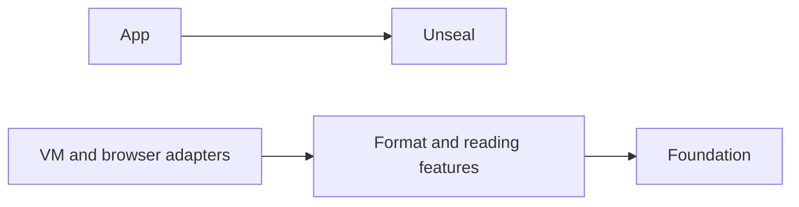

# Unseal architecture

This document explains the durable boundaries in Unseal. It is a map for
maintainers. It does not inventory every file or repeat generated scan output.

## Scope

Unseal accepts book bytes or a filesystem path and returns a common `Book`
model. The model contains metadata, resources, reading order, navigation,
covers, and statistics. Format-specific book types preserve details that do
not fit the common model.

Unseal owns parsing and reading data. It does not own:

- reader widgets, web views, or page rendering;
- media playback or text-to-speech;
- downloads, authentication, library storage, or synchronization, which
  belong to consuming applications.

The library stays pure Dart. The example may use Flutter, but `lib/` may not.

## Dependency direction

Applications may combine Unseal with their own renderer, audio, storage,
and networking layers. Unseal does not import those consumers. Inside Unseal,
features may depend on `foundation`; foundation types and policies must not
depend on a specific format.

## Public API

`lib/unseal.dart` is the default entry point. It exports the `Unseal` facade,
the common book model, reading services, typed exceptions, and stable
format-specific contracts.

Files such as `lib/epub.dart`, `lib/pdf.dart`, `lib/markdown.dart`,
`lib/rtf.dart`, `lib/palmdoc.dart`, `lib/chm.dart`, `lib/djvu.dart`,
`lib/tiff.dart`, `lib/lrf.dart`, `lib/alto.dart`, `lib/page.dart`, `lib/hocr.dart`, and
`lib/comic.dart` are narrow entry points for consumers that need one
format. Public signatures must use
types exported by the same public entry point. Consumers must not import
`lib/src/`.

PDF page diagnostics, EPUB structural diagnostics, and comic page roles remain format-specific contracts.
Applications decide whether to request OCR, hide pages marked `Delete`, or
render double-page spreads; Unseal only parses and reports the source data.
PDF additionally carries a format-specific structure layer
(`features/pdf/layout/`): words, blocks, columns, and tables with verifiable
geometry in the cropped, rotated page space, plus source anchors that map
into any canonical text of the page. Anchors are stable across reopenings
and across the eager/session extraction modes, whose canonical profiles
differ by the reflow plan revision; snapshot reuse the destination cannot
confirm fails typed instead of silently resolving.

The main operations are:

- `Unseal.read` and `Unseal.readMetadata` for portable asynchronous reads;
- `Unseal.inspect` for a full opening that returns either the parsed book or a
  typed failure together with a format-family hint;
- `Unseal.parse` and `Unseal.readMetadataSync` for synchronous formats;
- `Unseal.readFile` and `Unseal.readMetadataFile` on filesystem platforms;
- `UnsealWorker` for optional browser-worker execution;
- `BookSession.open` and `BookSession.openFile` for progressive EPUB, CBZ,
  CBR, PDF, and MOBI/AZW3 reads with a structure-only header and requested
  content.
- `BookSession.openSource` over a host-owned `UnsealByteSource` for
  progressive EPUB and CBZ reads by exact byte ranges.

CB7 and CBC remain asynchronous because their 7-Zip reader is asynchronous.

## Building blocks

| Area | Paths | Responsibility |
| --- | --- | --- |
| Common model | `lib/src/foundation/entities/` | Books, files, resources, navigation, metadata, and statistics shared by formats. |
| Shared safety and decoding | `lib/src/foundation/archive/`, `images/`, `text/`, `spatial/` | Archive access, path normalization, image inspection, plain text, XML decoding, the common text-identity contract (snapshots, revisions, ranges, digests) that format features bind positions to, and the minimal spatial contract (top-left rectangles, ALTO unit vocabulary, region/line/word zones with UTF-16 ranges, provenance, range lookups) that positioned-text features project onto. |
| Detection and dispatch | `lib/src/features/detection/`, `reading/`, `lib/src/platform/unseal_reader.dart` | Detect the format, refine ambiguous MOBI input, select the parser, and normalize public errors. |
| Format features | `lib/src/features/<format>/` | Parse one container or document family and build the common model. |
| Reading services | `lib/src/features/search/`, `locators/`, `cfi/`, `annotations/`, `opds/` | Search (scan and optional inverted index), portable locations, EPUB CFI, annotation serialization plus the durable anchor envelope and its W3C selector adapter, and OPDS catalog parsing (OPDS 1.x Atom and OPDS 2.0 JSON, bounded and network-free). |
| Progressive reading | `lib/src/features/progressive/` | Session headers, requested resources, bounded caches, session operations, and VM/browser transports. |
| Platform execution | `lib/src/platform/io/`, `web/`, `web/unseal_worker.dart` | Filesystem reads, isolate work, browser workers, and structured-clone wire codecs. |
| Heuristics | `lib/src/heuristics/` | Small format-neutral text and chapter heuristics. |

Keep a helper with the feature that owns its decision. Move code to
`foundation` only when separate features share the same stable rule.

## Read flow

1. A public facade receives bytes, an optional password, and read options.
2. Format detection checks bounded signatures and container structure.
3. Dispatch selects one format parser.
4. The parser validates its container before expanding or traversing data.
5. The parser builds a common `Book` model and, when needed, a subtype such as
   `EpubBook`, `ComicBook`, or `PdfBook`.
6. The facade normalizes format and implementation errors into public typed
   exceptions.

Metadata-only reads follow the same detection and safety boundaries but avoid
materializing content that the metadata path does not need.

File-based DjVu reads can resolve indirect documents. The I/O adapter loads
DIRM-named sibling components, checks names and declared sizes, and assembles
the bounded document before parsing. Byte-based opens reject indirect input;
Unseal does not fetch components from the network. DjVu hidden text decodes
into a per-page spatial structure that binds the stored zone tree (bottom-left
coordinates, all seven zone types) to canonical UTF-16 ranges under the stable
`djvu.hidden-text` profile; the DjVu wire payload carries each page's encoded
text chunk so wire-resident books rebuild the structure.

ALTO OCR sidecars import as a reading feature, not a book format: the host
supplies the OCR document and its link to a target page, Unseal parses the
declared subset (namespaces v2–v4, pixel/`mm10`/`inch1200` units, positioned
blocks, lines, strings with confidence) and binds its words onto a canonical
snapshot. Coordinate conversion requires a verified scale; repeated quotes
stay ambiguous with bounded candidate lists. Unseal does not run OCR.

PAGE XML sidecars (the PRImA vocabulary, exactly the 2019-07-15 namespace)
import the same way: metadata, page identity, all fifteen region kinds,
native polygons with explicitly derived bounding boxes, baselines, nested
reading order, and TextEquiv alternatives with confidence, language and a
deterministic lowest-index choice. Orientation stays a display-space hint
that never rotates coordinates. Binding maps the chosen text at the finest
declared granularity — words, then lines, then regions — onto a
host-confirmed snapshot with the same ambiguity and budget rules.

hOCR sidecars (the HTML class vocabulary Tesseract and other engines
emit) import the same way: pages, content areas, paragraphs, lines and
words in the producer's own nesting, integer pixel boxes, native
baselines with named projections, and the 0..100 word confidence
converted explicitly to the shared scale where absent, unknown and zero
stay distinct. An `order` or `cflow` reading order refuses typed;
document order is the only reconstruction Unseal offers. Binding follows
the same ambiguity and budget rules, with each line's region zone taken
from its nearest boxed ancestor.

## Progressive session flow

`BookSession` returns an `EpubBook`, `ComicBook`, `PdfBook`, or `MobiBook`
header whose `files` contains no content. A resident `SessionEngine` owns
the source and loads resources or PDF pages on request under `SessionPolicy`
cache limits.
The VM transport uses a long-lived isolate; the browser transport uses a
configured worker, with inline execution when the worker is unavailable.
Browser sessions have separate identifiers and engines so opening or disposing
one session does not replace another.

EPUB and CBZ use random-access ZIP entries; CBR uses the RAR entry source,
whose compressed entries decode while the session header sniffs page types
at opening. Solid RAR chains decode sequentially through a dictionary
owned by the session alone; backward access replays from bounded
checkpoints under a cumulative replay budget, so two sessions never
share mutable dictionary state.
PDF uses a random-access byte source and a reflow plan to
extract requested pages. MOBI/AZW3 sessions read PalmDB records through a
random-access record table and build their reading index with one
decompression pass over the text records at open — the bytes flow through
and only the record → stream-span table stays. MOBI 6 sections tile the
document at the table-of-contents anchors and intersect the document body
range; KF8 parts assemble per part over on-demand record slices, resolve
positions over bounded built-byte windows, and keep their linked-aid set
complete from open so any part finalizes in any order with the eager
markup outcome.

EPUB, CBZ and PDF sessions can also open over a host-owned byte source
(`UnsealByteSource`: length, revision identity, exact `readRange`,
close). For EPUB and CBZ, the engine uses an asynchronous container layer: one
end-of-central-directory tail scan, bounded central-directory windows,
then one local header and one compressed payload per entry, a Deflate
entry's whole compressed payload being its real decompression unit.
PDF instead drives the synchronous parser through bounded resident ranges
and explicit resume on cache misses. Each format
pulls its ranges from the host through a versioned
(`byteSource.v1`) bridge over the VM isolate or the Web Worker. The
host-side gate enforces the source contract, the session's in-flight
budgets, and the revision identity on the thread that owns the source;
other formats refuse the external-source path explicitly.

Whole-book search, statistics, and progression can
still traverse all content. The optional search index builds through bounded
batches with coverage accounting. `BookSession.metrics` reports container
reads, decode work, and materialized content, which is how progressive
delivery stays a measured property instead of an assertion.
Comic pages have no searchable text, and sessions do not perform OCR.

Cancellation fails pending requests while keeping the session usable. Host
reads that cannot be aborted retain their in-flight budget until settlement;
late answers cannot refill a canceled parser step. A one-request budget
therefore needs a pending physical read to settle before fetching again.
Disposal releases the transport and fails pending and subsequent requests.
Unsupported session formats fail explicitly; callers can use the eager APIs.

## Browser-worker flow

`UnsealWorker.configure` records the worker URL. A later asynchronous read can
send bytes and operation data to `web/unseal_worker.dart`. The worker parses
the book and sends a versioned, structured-clone-safe representation back.

If the worker cannot start, Unseal uses the browser's main thread. This keeps
the API available, but a large parse can block the UI. Wire changes must stay
backward-consistent within one release and require Chrome tests.

## Safety boundaries

Input is untrusted. The following rules are architectural, not parser details:

- Normalize archive paths before lookup or extraction.
- Reject encrypted entries, symbolic links, unsupported compression methods,
  excessive expansion, and oversized output before materialization. RAR 5
  decoding verifies header CRCs, allocates the declared output before
  decompressing, and caps declared dictionaries at 64 MiB.
- Bound PDF objects, page trees, content streams, and image decoding.
- Bound DjVu IFF chunks, page count, direct JPEG payloads, OCR text, JB2
  masks, symbols, records, arithmetic contexts, blit work, and IW44 chunks,
  slices, coefficient work, and cumulative decoded raster output before
  materializing page resources. BZZ output and shared JB2 dictionaries have
  separate allocation budgets; indirect components allow only validated
  sibling names and matching declared sizes.
- Bound TIFF/BigTIFF IFD traversal, entry counts, offsets, strip and tile
  footprints, decoded pixels, resident bytes (page images plus live scratch),
  and decode work before allocation; validate every page's segment layout as
  a whole (bounds, header, directory, and mutual overlap) first. Reject
  unsupported codecs and raster layouts with format-owned typed failures.
- Bound JPEG 2000 codestream reads (input bytes, per-component raster samples,
  native planes, tile buffers, reference-grid projections, PNG scanlines,
  component and tile counts) before allocation. The decoder lives beside the
  PDF feature, enforces a documented Part 1 subset (unsigned 8-16 bit
  components, per-component sample grids, JP2 sYCC), rejects unsupported
  features with typed failures, and must decode identically on the VM and on
  compiled JavaScript (integer shifts normalized).
- Bound XML depth and convert malformed or excessive structures to typed
  failures. EPUB diagnostics preflight XML at 16 MiB, 128 nesting levels,
  and one million elements. ALTO preflights nesting and element counts before
  allocating a DOM and rejects non-finite geometry. OPDS 2.0 preflights
  bytes, JSON depth, value count, string length, and per-collection counts
  before mapping and reports failures with JSON pointers.
- Preserve HTML as data. A consuming renderer must sanitize or isolate it.
- Reject unsupported DRM. Do not attempt to bypass access controls.

RTF bounds group nesting and generated HTML, while PalmDOC, eReader, and Plucker bound
each compressed and decompressed text record. Format-specific limits may differ
because the formats have different cost models. The public README records the
user-visible limits and exclusions.
CHM bounds its ITSF directory, LZX reset table, decompressed entries and total
materialized content before allocating untrusted output.
LRF bounds indexed objects, pages, metadata inflation, and expanded zlib
streams before exposing reflowed content. LRX2 metadata reads are limited to
the plaintext nested metadata stream; book content is rejected as DRM-protected.

Search indexes and durable anchors share the immutable canonical-text identity
contract in `foundation/text/`. Persisted positions require verified destination
text and matching identity, occurrence, and extraction profile. PDF profiles
include the reflow plan and its eager or progressive scope. Importing an index
without a destination permits structural inspection only. Applications own
storage; changing extraction modes requires rebuilding an index or explicitly
migrating an anchor. Incomplete anchor scans cannot establish uniqueness.

## Testing strategy

- Unit tests cover codecs, metadata, models, and narrow parser decisions.
- Format tests cover valid files, corrupt input, security limits, and typed
  failures.
- Public-contract tests ensure entry points compile without private imports.
- Chrome tests cover conditional imports, worker behavior, and web codecs.
- Deterministic fuzz tests exercise hostile structures with reproducible
  seeds and process-level deadlines.
- Benchmarks measure detection, metadata reads, full parsing, and selected
  hot paths. They are evidence, not release gates by themselves.

Fixtures under `test/resources/` are part of the test contract. Preserve their
bytes and provenance unless the change intentionally updates the fixture.

## Decisions and known limits

- Pure Dart portability takes priority over platform-native parsers.
- One common reading model takes priority over reproducing every source
  application's layout model.
- PDF support targets reading and extraction. It is not a full PDF renderer.
- DjVu full opening accepts directly stored JPEG pages, local or shared JB2
  masks, and progressive IW44 `BG44`/`FG44` layers. It composes supported
  mixed layers through a hard JB2 mask, reads compressed hidden text and
  bookmark navigation, and resolves indirect files only through filesystem
  reads. Chained shared dictionaries and replacement visual codecs remain
  unsupported. `FGbz` palette recoloring is ignored.
- TIFF/BigTIFF produces page images rather than reflowed text. Strip and
  tiled pages share the codecs documented in the README and are compared
  sample by sample with libtiff (`doc/tiff-tiles.md`); planar, palette,
  float, JPEG-tiled, transposed, and other unsupported raster layouts fail
  explicitly.
- PDF `JPXDecode` extracts images through the JPEG 2000 subset decoder; the
  acceptance contract is the pinned OpenJPEG oracle (exact lossless on native,
  upsampled and colour-converted planes, pre-fixed lossy ceilings; contract and
  policies in `doc/jpeg2000-precision.md`), and the PDF dispatch keeps
  text/reflow untouched.
- DOCX and ODT conversion preserves semantic reading structure, not exact page
  layout.
- HTML remains unsanitized so parsing does not silently rewrite content.
- Optional damaged metadata or navigation may be skipped when readable content
  remains, but structural corruption and safety-limit violations must fail.

Record a separate architecture decision when a change reverses one of these
choices or introduces a new cross-package dependency.

## Keeping this document current

Update this file when a public entry point, dependency direction, building
block responsibility, critical runtime flow, or safety boundary changes. Do
not add file counts, scan results, temporary paths, release status, or a list
of every class. Those facts become stale faster than the architecture.
